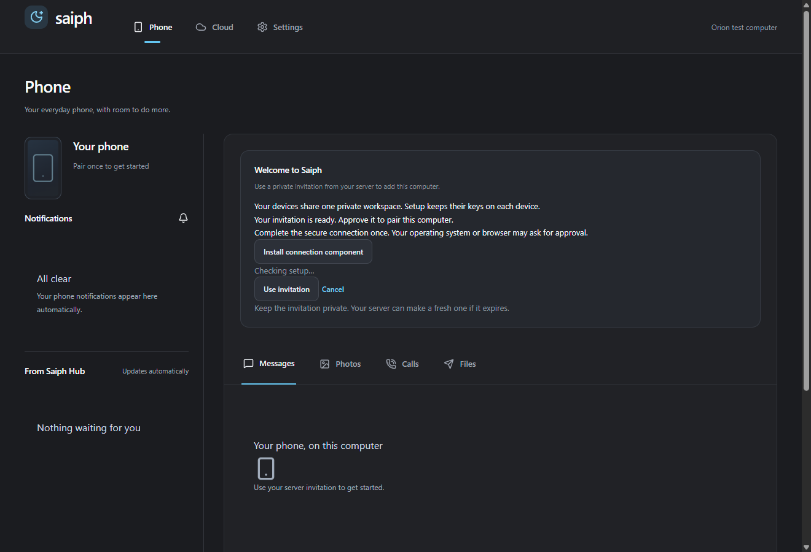

# Saiph

Connect your Android phone and Windows or Linux computers with a Saiph account,
or, if you choose to self-host, through a Hub you run yourself. Saiph brings phone notifications, clipboard sharing, files and device
continuity into one desktop app. Internal packages and compatibility identifiers
still use the Orion name.

**Status: beta preparation.** This repository contains the Link desktop app, Hub,
Android app, SDK and website. Hosted is planned. Native sign-in, device approval and encryption
integration across shipping features still need acceptance on physical devices;
there has been no independent security review. Availability and permissions vary
by Android version and phone manufacturer.

Shared hosted beta preparation and clean-install acceptance are described
in [the hosted beta guide](docs/HOSTED_FRIENDS_BETA.md). It uses account-bound
invitation codes; deployment and installer distribution are still pending.



Actual Windows Link build with an isolated test profile and synthetic invitation;
no phone is paired in this screenshot.

## Get started

The apps start on Saiph account sign-in. With a Saiph account you install only the
desktop and Android apps: no server, and no Tailscale or other network software
on your phone or computer. The steps below are for self-hosting, which you choose
explicitly during setup with **I self-host my own Hub**.

1. Read the [self-hosting guide](docs/ORION_SELF_HOSTED_SERVER.md) and run the Hub on a
   Linux server or Raspberry Pi reachable over your private Tailscale or Headscale
   network. The Hub should not be exposed directly to the internet.
2. Install a Saiph desktop release for your OS and the matching Android release.
   This preparation snapshot does not yet provide signed public installers or a
   published Android download. Build instructions are below.
3. Pair devices using the enrollment instructions in the guide. Grant only the
   Android permissions needed for the features you use.
4. Test with a synthetic notification and clipboard text before using real data.

Saiph's current Android app is maintained in [android/](android/README.MD), a fork of
[Sefirah Android](https://github.com/shrimqy/Sefirah-Android), with its GPL licence
and upstream credits retained. The older `android-app/` monorepo app is not the
current supported release source and is not included here.

## How it fits

Saiph overlaps with [KDE Connect](https://kdeconnect.kde.org/),
[Phone Link](https://www.microsoft.com/windows/sync-across-your-devices), and
[Sefirah](https://github.com/shrimqy/Sefirah). Its focus is an Android companion
for Windows and Linux with a Hub under your control and a path to optional
hosted operation. This is not a feature-parity or performance claim. Use the
project that fits your devices; Saiph is still beta software.

Deskflow integration connects to a separately installed keyboard and mouse
sharing tool. Saiph does not replace Deskflow's network or security model.

## ToDo features

This backlog gathers unfinished work and ideas from the existing product plans.
Items marked **acceptance** already have source implementations but still need
real-device validation. Later ideas need a scope and feasibility discussion;
their inclusion is not a delivery-date commitment.

### Finish and validate

- [ ] **Unified setup — in progress:** the desktop now has installer option pages
  (Windows and Linux) and a first-run setup guide (connect, add your phone, choose
  features, optional tools) — acceptance pending on clean machines. Still to do:
  Android-side guided setup alignment, updates and recovery.
- [ ] **Everyday reliability — acceptance:** verify background clipboard and
  notifications, sleep/reboot recovery, network changes, interrupted transfers
  and sustained use across supported Android, Windows and Linux/Wayland devices.
- [ ] **Phone webcam and microphone — acceptance:** validate the existing video
  and audio integrations in real meeting apps, including disconnect, mute,
  stop and permission changes.
- [ ] **Hosted beta — acceptance:** complete clean-install sign-in, device
  approval/revocation, encrypted sharing and recovery after the root goes offline.
  See [Hosted preview scope](docs/HOSTED_PREVIEW.md) and
  [beta acceptance](docs/HOSTED_FRIENDS_BETA.md).
- [ ] **Security release — deployment:** roll out the October 2026 hosted fixes
  to the hosted service and desktop 0.1.0-beta.4, restrict account sign-up, and
  complete an independent review of friends-beta mode before publishing this
  repository. See [release status](docs/RELEASE_STATUS.md) and the
  [public release checklist](docs/PUBLIC_RELEASE_CHECKLIST.md).

### Feature backlog

- [ ] **Hosted QR enrollment — acceptance:** Android scans the desktop's signed
  root QR with the pairing camera scanner (or takes the pasted code) and requires
  the same full-fingerprint confirmation. Needs physical-device acceptance.
- [ ] **Live Do Not Disturb sync — acceptance:** `focus.state` shares the newest
  on/off change between all paired devices, and the Hub snapshot covers late
  reconnects. Android follows interruption-filter changes and applies Saiph's own
  rule; the desktop reads Windows DND (read-only) and GNOME banners and has a
  Phone page toggle. Needs acceptance on real Android, Windows and GNOME devices,
  including the Android 15+ limit on ending DND started on the phone.
- [ ] **Phone remote for desktop apps — acceptance:** the phone requests a
  computer's catalog (`remote.catalog.request`), shows its apps as a table and
  sends `remote.command` with fixed controls or bounded text. Adapters: media,
  presentation, web video, lock and opt-in typing. Off by default, per-phone and
  per-adapter, rate-limited, foreground-checked; see the security model. Needs
  real-app acceptance on Windows and X11; Wayland only supports media. More
  adapters (for example terminal/assistant sessions) need their own scope.
- [ ] **Phone photo into a desktop task — acceptance:** "Photo to computer" on
  Android sends the photo with `file.offer` plus a `capture.insert` digest, so
  older Hubs still relay it; the desktop verifies it and puts it on the
  clipboard with a "ready to paste" notice. Needs device acceptance. Document
  scanning with edge correction still needs a dependency decision.
- [ ] **Phone hotspot connect/reconnect — acceptance:** choose a saved Wi-Fi
  profile, connect in one click (`netsh wlan` / `nmcli`, never a shell), and
  reconnect automatically after a 30-second outage with no other network route.
  The phone app opens Android hotspot settings. Needs real hotspot checks on
  Windows and Linux.
- [ ] **Deskflow setup polish — acceptance:** setup checks for the executable,
  certificate, approved trust file, mesh address and running state; detected
  values; Restart sharing; and crash backoff. Needs a two-computer check.
- [ ] **Hosted root transfer and lost-root recovery — design needed:** move
  trust to another approved device and define recovery without giving the server
  access to content keys.
- [ ] **More Hosted features — scope to decide:** evaluate clipboard images,
  photo-library browsing, SMS and supported phone actions. The current preview
  covers text clipboard, notifications and explicitly selected files/photos.
- [ ] **Phone-to-computer app/session control — design needed:** continue a
  selected terminal or assistant session from the phone, with explicit access,
  revocation and disconnect handling. GUI app control needs its own scope.

### Phone Link replacement

Saiph should make Microsoft Phone Link unnecessary on Windows, and offer the
same on Linux, for any phone brand and without a Microsoft account. The full
checklist, design and order are in the
[Phone Link replacement plan](docs/PHONE_LINK_PARITY.md).

- [ ] **Acceptance:** phone media controls on the computer (D).
- [ ] **Acceptance:** new messages with contact search (A1), MMS pictures (A2) and group replies (A3). Sending a picture by MMS from the computer is not built yet.
- [ ] **Acceptance:** phone panel, tray Phone menu and ringer mode (C).
- [ ] **Acceptance:** lock this PC from the phone, opt-in (E).
- [ ] **Acceptance:** dial from the computer and call history (B1).
- [ ] **Acceptance:** new screenshots and photos offered on the computer (G).
- [ ] **Acceptance:** Send to phone from File Explorer, GNOME Files and Dolphin (H).
- [ ] **Acceptance:** phone apps in their own windows, with Pin (J).
- [ ] Calls through the computer's audio: research spike first (B2).
- [ ] Phone storage in File Explorer and Linux file managers (F).

Apple-style continuity, from the same plan:

- [ ] **Acceptance:** sketch and markup to the computer (K).
- [ ] **Acceptance:** batteries for all devices on the phone (L); a home-screen widget is not built yet.
- [ ] **Acceptance:** phone as touchpad and keyboard (M).
- [ ] **Acceptance:** find this computer: ring it from the phone (N).
- [ ] **Acceptance:** lock this computer when the phone leaves, on Linux (O).

### Smaller conveniences

- [ ] **Acceptance:** "Copy code" for one-time codes in phone notifications,
  with optional automatic copying (off by default).
- [ ] **Acceptance:** ring my phone from the desktop at alarm volume for up to 30
  seconds (new `phone.ring` event and `ring` capability).
- [ ] **Acceptance:** one desktop alert when a phone drops to 20% and is not charging.
- [ ] **Acceptance:** pause playing desktop media during phone calls and resume
  only what was paused (playerctl on Linux; Windows needs the optional
  `winrt-Windows.Media.Control` binding, which is not yet a dependency).
- [ ] **Acceptance:** home-screen widget showing whether Saiph is on, with Pause /
  Resume; pausing stops all syncing until resumed, including after a reboot.
- [ ] Remote adapters for terminal/assistant sessions and per-app layouts
  (for example a meeting app's mute/camera/leave buttons).
- [ ] Nearby discovery and file sharing without the private mesh, for Linux
  (Quick Share already covers Windows).
- [ ] Optional OneDrive/Google and other provider integrations where they remove
  a specific workflow inconvenience.

Not planned, because phones and browsers already do it well: locating, locking
or erasing a lost phone (Google Find My Device, Samsung SmartThings Find),
continuing browser tabs (browser sync), document scanning (Google Drive/Lens,
Samsung Notes) and sharing Wi-Fi by QR code (Android settings).

For signing, public installers and other release gates, see
[release status](docs/RELEASE_STATUS.md). To propose an idea or pick up an item,
follow [CONTRIBUTING.md](CONTRIBUTING.md) and discuss its scope before starting
a substantial change. Keep this list current as features land and acceptance
checks pass.

## Build from source

On Windows or Linux x86_64, install Python 3.12 and Node 24, create and activate a
virtual environment, then run:

```text
python -m pip install -e ".[dev,hosted]" -r hub/requirements-hosted.txt httpx
npm --prefix frontend ci
python scripts/public-release/verify-public.py
npm --prefix frontend run test:unit
python scripts/build-native.py --profile link
```

The native bundle is under `dist/Saiph/` (`dist/saiph/` on Linux) and its executable
is `Saiph.exe` (`saiph`). Linux also needs Qt/WebEngine system libraries (see public CI).
Hub dependencies and hosted tests run separately on Python 3.12 using
`hub/requirements-hosted.txt`. See [contribution instructions](CONTRIBUTING.md).

## Licence, security and releases

App and Hub: **AGPL-3.0-or-later**, see [LICENSE](LICENSE). Android: **GPL-3.0-only**, see [android/LICENSE](android/LICENSE). SDK: **MIT**, see
[sdk/LICENSE](sdk/LICENSE). Upstream components retain their licences; see
[third-party notices](THIRD_PARTY_NOTICES.md). Names and logos have a separate
[branding policy](TRADEMARKS.md).

Report vulnerabilities privately using [SECURITY.md](SECURITY.md). Contributions
and community participation follow [CONTRIBUTING.md](CONTRIBUTING.md) and
[CODE_OF_CONDUCT.md](CODE_OF_CONDUCT.md).

**Code signing policy:** public Windows signing is not yet configured. CI artifacts
are unsigned development builds and must not be presented as signed releases.
The [release guide](docs/RELEASING.md) records the signing, checksum, source and
third-party review gates. Paired-device screenshots and a clean-machine installation
check remain release tasks; the website's device animations are illustrative.

Read the [user guide](docs/USER_GUIDE.md), [architecture](docs/ARCHITECTURE.md),
[security model](docs/SECURITY_MODEL.md) and [testing guide](docs/TESTING.md) for
the supported public scope and its current limits.

See [repository layout](docs/REPOSITORY_LAYOUT.md) for component ownership and [current release gaps](docs/RELEASE_STATUS.md).
