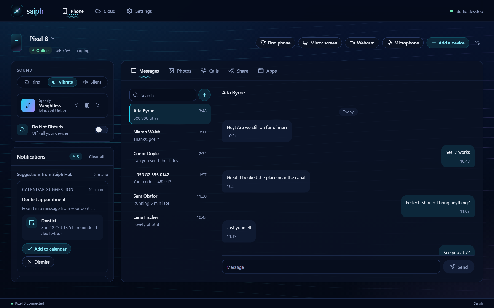
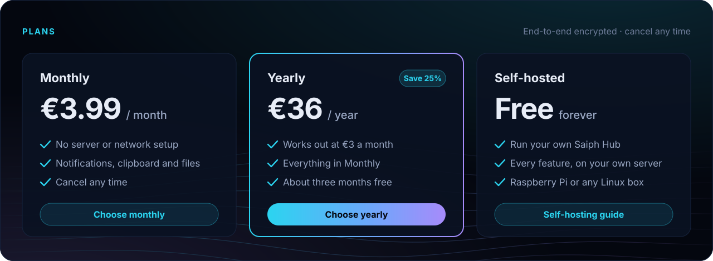
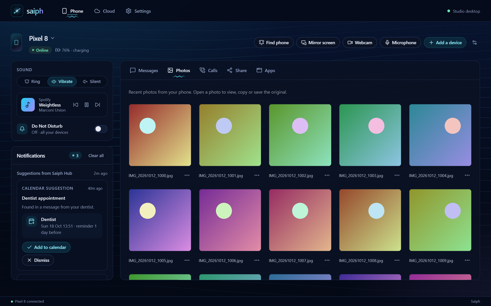
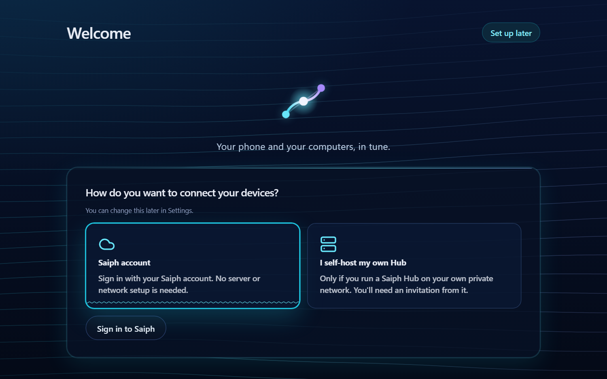

<p align="center">
  <a href="https://usesaiph.com"></a>
</p>

<p align="center">
  <a href="https://usesaiph.com"><b>Website</b></a> ·
  <a href="https://usesaiph.com/#pricing"><b>Get Saiph Hosted</b></a> ·
  <a href="docs/ORION_SELF_HOSTED_SERVER.md">Self-host</a> ·
  <a href="docs/USER_GUIDE.md">User guide</a> ·
  <a href="docs/SECURITY_MODEL.md">Security model</a>
</p>

Copy on your phone, paste on your laptop. See your phone's notifications on the
screen you're at. Send a photo across without a cable.

**Saiph** connects your Android phone with your Windows and Linux computers, so
they work as one: clipboard, notifications, photos, files, texts and calls, in a
single desktop app. Like Apple's Continuity, without buying every device from
one company.

> A friend told me the Apple ecosystem can't be beaten, so I built one that works
> on everything.
>
> — Alexander, creator of Saiph

<p align="center">
  
</p>

## Saiph Hosted is here

Sign in, install, and your devices are connected. **Saiph Hosted** runs the
connection for you: no server, no Tailscale, no port forwarding, nothing to keep
running at home. Your devices encrypt content before it leaves them, and only
the devices you approve can read it.

<p align="center">
  <a href="https://usesaiph.com/#pricing"></a>
</p>

| | Monthly | Yearly | Self-hosted |
| --- | --- | --- | --- |
| Price | **€3.99** / month | **€36** / year, €3 a month | **Free** |
| You need | A Saiph account | A Saiph account | Your own Linux server or Raspberry Pi |

Cancel any time; your access runs to the end of the period you paid for.

**[Subscribe at usesaiph.com →](https://usesaiph.com/#pricing)**

Saiph Hosted is a beta service: expect the odd bug and occasional downtime while
it grows. Texts and calls are coming to it next.

What you get with Hosted:

- **Your devices hold the keys.** Content is sealed for your approved devices
  before it is relayed. Signing in or paying never unlocks it.
- **Devices approve devices.** Your main computer approves your phone and other
  computers after you compare their fingerprints, and you can revoke a lost
  device in one click.
- **Your account, kept separate.** Each account has its own storage. Some
  metadata is visible to the service: your account, device public keys,
  connection times and message sizes. See the [security model](docs/SECURITY_MODEL.md).
- **Your subscription funds the project.** Saiph is built independently, and
  Hosted is how it stays that way. Self-hosting stays free.

## What it does

| | Saiph Hosted | Self-hosted Hub |
| --- | :---: | :---: |
| **Notifications** — see and dismiss your phone's notifications on any computer | ✓ | ✓ (and reply) |
| **Clipboard** — copy on one device, paste on another | ✓ text | ✓ text and images |
| **Photos & files** — send them either way, without a cable | ✓ | ✓ and browse recent photos |
| **Texts** — read and reply with a real keyboard, still from your number | Coming | ✓ |
| **Calls** — see who's calling, answer or decline, dial from the computer | Coming | ✓ |
| **Webcam & microphone** — use your phone's camera in video calls | Over USB or local Wi-Fi | Over USB or local Wi-Fi |
| **Phone controls** — find your phone, ringer mode, media, Do Not Disturb | | ✓ |
| **Cloud folder** — a synced folder on storage you choose | | ✓ |
| **Keyboard and mouse sharing** — with a separately installed [Deskflow](docs/ORION_DESKFLOW.md) | | ✓ |

Saiph runs on **Windows 10/11 (x64)**, **Linux (x86_64)** and **Android**.
Some features depend on your Android version and phone manufacturer.

<p align="center">
  
  
</p>

## Get started

**With Saiph Hosted:**

1. Subscribe at [usesaiph.com](https://usesaiph.com/#pricing) and download Saiph
   for your computer and phone from your account.
2. Open Saiph on your computer, choose **Saiph account** and sign in. Then choose
   **Set up this computer**: it becomes the device that approves your others.
3. Open Saiph on your phone and sign in with the same account. Compare the
   fingerprint on both screens and approve the phone on your computer.
4. Choose what to share, such as notifications, and send some harmless clipboard
   text both ways to check it works.

**Self-hosting:** run the Hub on a Linux server or Raspberry Pi on your private
Tailscale or Headscale network, then choose **I self-host my own Hub** in the
desktop setup guide. The [self-hosting guide](docs/ORION_SELF_HOSTED_SERVER.md)
covers installation and pairing. Don't expose the Hub directly to the internet.

The [user guide](docs/USER_GUIDE.md) explains every feature and its permissions.

## How Saiph compares

Saiph overlaps with [KDE Connect](https://kdeconnect.kde.org/),
[Phone Link](https://www.microsoft.com/windows/sync-across-your-devices) and
[Sefirah](https://github.com/shrimqy/Sefirah). Its focus is one Android companion
for both Windows and Linux, either hosted for you with end-to-end encryption or
on a Hub under your own control, without a Microsoft account. Use whichever
project fits your devices best.

## What's next

- **Texts and calls on Hosted**, matching the self-hosted Hub.
- **Replacing Phone Link** on Windows, and offering the same on Linux, for any
  phone brand: MMS and group texts, phone apps in their own windows, phone
  storage in your file manager. See the [Phone Link replacement plan](docs/PHONE_LINK_PARITY.md).
- **Continuity extras:** sketch to the computer, the phone as a touchpad and
  keyboard, ring your computer from the phone, and lock the computer when your
  phone leaves.
- **Signed installers** with a trusted publisher, and an independent security
  review of Hosted.

Current gaps and acceptance checks are tracked in
[release status](docs/RELEASE_STATUS.md) and
[pending acceptance](docs/ACCEPTANCE_PENDING.md). Saiph is beta software:
Windows installers are not yet signed with a trusted publisher (check the
supplied checksum), and there has been no independent security review yet.

## This repository

| Path | What's in it |
| --- | --- |
| [`src/`](src/), [`frontend/`](frontend/) | The desktop app: a Python service with a React interface ([design system](docs/DESKTOP_DESIGN_SYSTEM.md)) |
| [`hub/`](hub/) | The Saiph Hub, for self-hosting, and the Hosted service |
| [`android/`](android/README.MD) | The Android app, a fork of [Sefirah Android](https://github.com/shrimqy/Sefirah-Android) with its GPL licence and upstream credits retained |
| [`sdk/`](sdk/) | A small Python client that lets your own scripts and tools report status to the desktop app ([plugins](docs/PLUGINS.md)) |
| [`website/`](website/), [`account-web/`](account-web/) | usesaiph.com and the account site |

Some internal packages and identifiers still use the earlier name, Orion, so
existing pairings and installs keep working. See the
[architecture](docs/ARCHITECTURE.md) and [repository layout](docs/REPOSITORY_LAYOUT.md).

### Build from source

On Windows or Linux x86_64, install Python 3.12 and Node 24, create and activate
a virtual environment, then run:

```text
python -m pip install -e ".[dev,hosted]" -r hub/requirements-hosted.txt httpx
npm --prefix frontend ci
python scripts/public-release/verify-public.py
npm --prefix frontend run test:unit
python scripts/build-native.py --profile link
```

The native bundle is in `dist/Saiph/` (`dist/saiph/` on Linux), and its
executable is `Saiph.exe` (`saiph`). Linux also needs the Qt/WebEngine system
libraries. To preview the desktop interface on synthetic data, run
`npm --prefix frontend run dev` and open `/preview.html`. The
[testing guide](docs/TESTING.md) covers the desktop, Hub and Hosted suites.

## Contributing

Ideas, bug reports and pull requests are welcome. Read
[CONTRIBUTING.md](CONTRIBUTING.md) and discuss the scope of a substantial change
before starting it. Commits are signed off under the [DCO](DCO.txt), and
community participation follows the [code of conduct](CODE_OF_CONDUCT.md).

Please report vulnerabilities privately, as described in [SECURITY.md](SECURITY.md).

## Licence

The desktop app and Hub are **AGPL-3.0-or-later** ([LICENSE](LICENSE)). The
Android app is **GPL-3.0-only** ([android/LICENSE](android/LICENSE)). The SDK is
**MIT** ([sdk/LICENSE](sdk/LICENSE)). Upstream components keep their own
licences; see the [third-party notices](THIRD_PARTY_NOTICES.md). The Saiph name
and logo are covered by the [branding policy](TRADEMARKS.md).

<sub>Apple and Continuity are trademarks of Apple Inc. Saiph is an independent
project, not affiliated with or endorsed by Apple. Screenshots show the desktop
app's design preview with made-up data.</sub>
